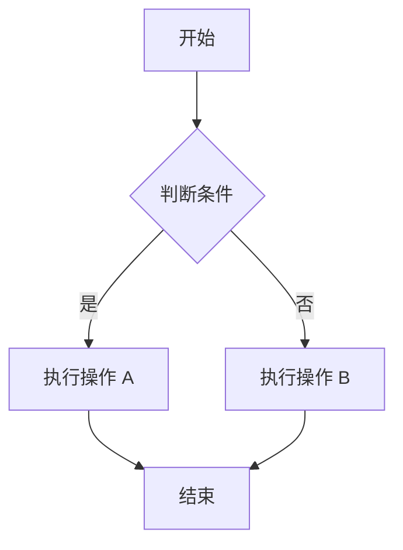
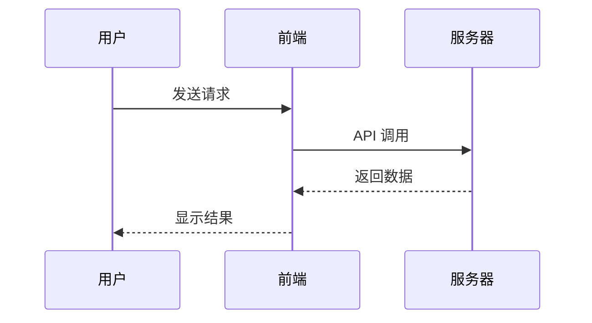
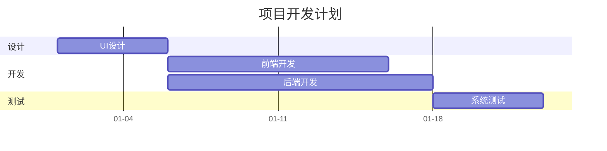
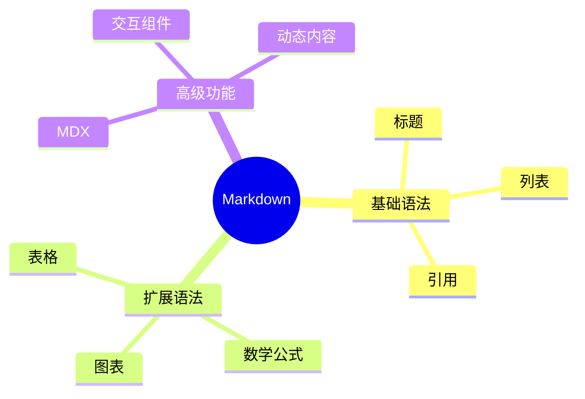
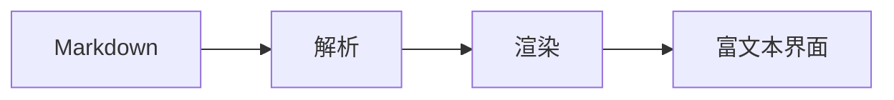

+++
title = "Markdown 全语法综合测试"
date = "2026-10-31T12:00:00+08:00"

description = "通过完整文章检查 Markdown 常用语法、GFM 扩展、公式、图表、HTML 混排和组件标签。"
slug = "markdown-feature-showcase"
path = "posts/markdown-feature-showcase"
draft = false

[taxonomies]
tags = ["Markdown", "语法测试", "Mermaid", "数学公式"]
[extra]
math = true
+++

# 一级标题 H1
## 二级标题 H2
### 三级标题 H3
#### 四级标题 H4
##### 五级标题 H5
###### 六级标题 H6

---

## 1. 文字样式 {#text-style}
普通文本

**粗体文字** *斜体文字* ***粗斜体文字*** ~~删除线~~ <u>下划线</u> ==高亮文字== `行内代码`

H<sub>2</sub>O · X<sup>2</sup> · <sup>2</sup> · <sub>2</sub> · <kbd>Ctrl</kbd> + <kbd>C</kbd>

---
## 2. 引用块
> 普通引用
>> 第一层引用
>>> 第二层引用

---
## 3. 列表
- 无序列表
- 第二项
  - 子项目 A
  - 子项目 B
1. 有序列表
2. 第二步

### 任务列表
- [x] 已完成
- [x] 已检查
- [ ] 待处理
- [ ] 待发布

---
## 4. 链接
[OpenAI](https://openai.com) · <https://example.com> · [带标题的链接](https://example.com "提示文字")

---
## 5. 图片


[](https://unsplash.com/)

---
## 6. 表格
| 名称 | 类型 | 状态 |
|:---|:---:|---:|
| Markdown | 文档 | ✅ |
| Mermaid | 图表 | ✅ |
| MDX | 组件 | 🚀 |

---
## 7. 代码块 {#code-blocks}

### 语言标注示例

```python
print("Hello")
```

```python
def hello(name):
    return f"Hello, {name}!"
print(hello("World"))
```
```javascript
const user = {name:"Alice",age:20,active:true};
console.log(user);
```
```json
{"name":"Markdown","version":"1.0","enabled":true}
```
```diff
- const oldValue = 10;
+ const newValue = 20;
```

---
## 8. 数学公式
行内公式：$E = mc^2$
$$
E = mc^2
$$
积分：$$\int_{-\infty}^{+\infty} e^{-x^2} dx = \sqrt{\pi}$$
矩阵：$$A = \begin{bmatrix}1 & 2 & 3 \\ 4 & 5 & 6 \\ 7 & 8 & 9\end{bmatrix}$$

---
## 9. Mermaid 流程图


---
## 10. Mermaid 时序图


---
## 11. Mermaid 甘特图


---
## 12. Mermaid 思维导图


---
## 13. 提示块（GitHub 风格）
下面把每一种提示块单独展示，便于对照浅色与暗色主题中的边框、背景和标题颜色。

### INFO · 信息
> [!NOTE]
> 这是信息提示：用于补充背景或说明。

### TIP · 技巧
> [!TIP]
> 这是实用技巧：用于给出可操作的建议。

### IMPORTANT · 重要
> [!IMPORTANT]
> 这是重要提示：用于强调关键内容。

### WARNING · 警告
> [!WARNING]
> 这是警告提示：用于提醒潜在问题。

### CAUTION · 注意
> [!CAUTION]
> 这是注意提示：用于提示高风险操作。

---
## 14. 折叠面板（HTML 扩展）
<details><summary>点击展开内容</summary>
这里是隐藏内容。可以放文字、代码和其他元素。
</details>

---
## 15. 脚注
这里是一段带脚注的文字。[^1]
[^1]: 这是脚注内容。

---
## 16. 定义列表
Markdown
: 一种轻量级标记语言
MDX
: 允许在 Markdown 中嵌入组件的格式

---
## 17. Emoji
😀 😎 🚀 🔥 💡 ✅ ❌ ⚠️ 📌 ⭐ 📊 📈 📉 💻 🎨

---
## 18. HTML 混合排版
<div align="center">
### 居中标题
这是一段居中文字。
</div>
<mark>高亮文字</mark> <small>小号文字</small> <del>删除文字</del> <ins>插入文字</ins>

---
## 19. 目录锚点
[跳转到文字样式](#text-style) · [跳转到代码块](#code-blocks)

---
## 20. 卡片组件
<div class="demo-card"><strong>🚀 功能卡片</strong><p>这是卡片的正文内容。</p></div>

---
## 21. 标签页
<div class="demo-tabs"><div class="demo-tab-buttons" role="tablist" aria-label="语言示例"><button type="button" role="tab" aria-selected="true" data-panel="demo-python">Python</button><button type="button" role="tab" aria-selected="false" data-panel="demo-javascript">JavaScript</button></div><div id="demo-python" class="demo-tab-panel" role="tabpanel"><code>print("Hello")</code></div><div id="demo-javascript" class="demo-tab-panel" role="tabpanel" hidden><code>console.log("Hello");</code></div></div>

---
## 22. 交互按钮
<div class="demo-actions"><button type="button" class="demo-button primary">点击按钮</button><button type="button" class="demo-button secondary">次要按钮</button></div>

---
## 23. 进度条
<label class="demo-progress-label" for="feature-progress">完成进度 75%</label><progress id="feature-progress" value="75" max="100">75%</progress>

---
## 24. 徽章
<div class="demo-badges"><span class="demo-badge green">成功</span><span class="demo-badge yellow">处理中</span><span class="demo-badge red">失败</span></div>

---
## 25. 警告框
<div class="demo-alert success">操作成功！</div><div class="demo-alert warning">请检查输入内容。</div><div class="demo-alert error">发生错误。</div>

---
## 26. 网格布局
<div class="demo-grid"><div class="demo-card"><strong>卡片 A</strong><p>内容 A</p></div><div class="demo-card"><strong>卡片 B</strong><p>内容 B</p></div><div class="demo-card"><strong>卡片 C</strong><p>内容 C</p></div></div>

---
## 27. 图表组件
<div class="demo-chart" role="img" aria-label="一月 30，二月 50，三月 80"><div><span>一月</span><i style="--bar-value:30%"></i><b>30</b></div><div><span>二月</span><i style="--bar-value:50%"></i><b>50</b></div><div><span>三月</span><i style="--bar-value:80%"></i><b>80</b></div></div>

---
## 28. 交互表单
<div class="demo-form"><label>输入文字 <input placeholder="请输入内容"></label><label>选择选项 <select><option value="a">选项 A</option><option value="b">选项 B</option></select></label><label><input type="checkbox"> 我已阅读并同意</label><label>调整数值 <input type="range" min="0" max="100" value="50"></label></div>

---
## 29. 分割线
---
***
___

---
## 30. 综合展示
# 🚀 现代 Markdown 展示
> [!IMPORTANT]
> 这是一个综合示例。
### 功能进度
- [x] 基础排版
- [x] 代码高亮
- [x] 数学公式
- [x] 图表支持
- [ ] 动态交互
### 数据统计
| 指标 | 数值 | 趋势 |
|---|---:|---|
| 用户量 | 12,500 | 📈 |
| 访问量 | 88,000 | 📈 |
| 错误率 | 0.2% | 📉 |
### 流程

### 数学表达
$$f(x)=\frac{1}{1+e^{-x}}$$
**完成！**
